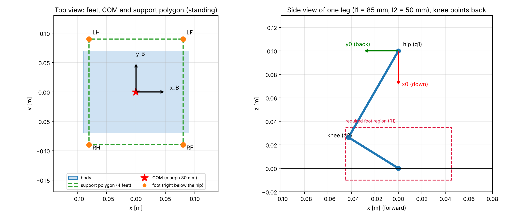
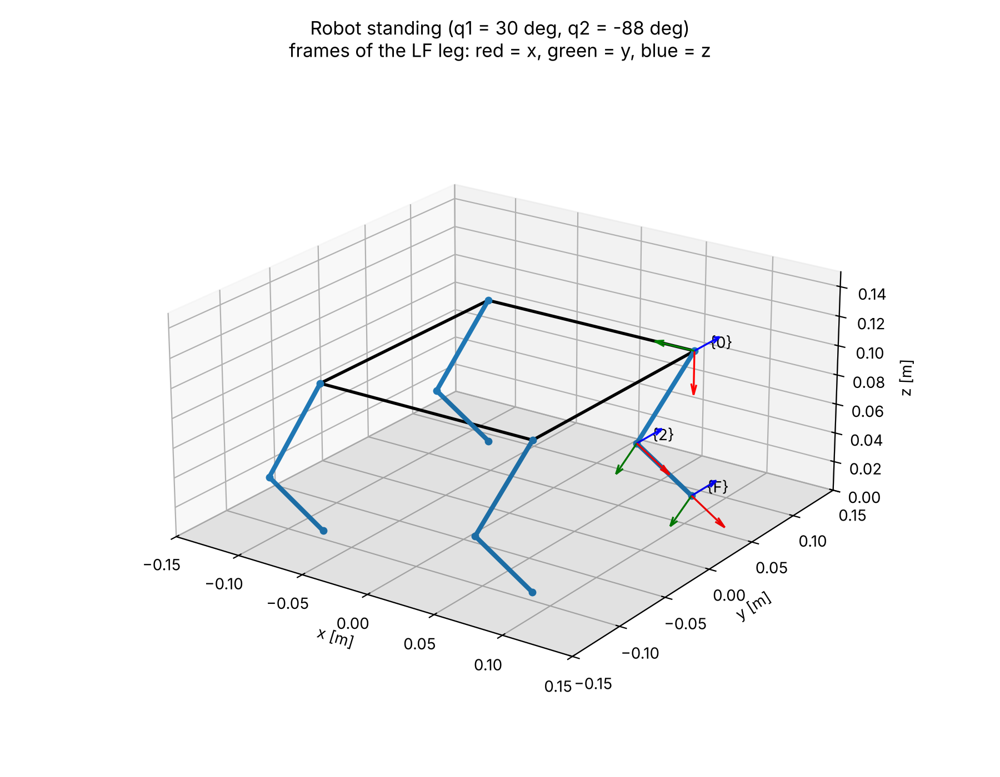
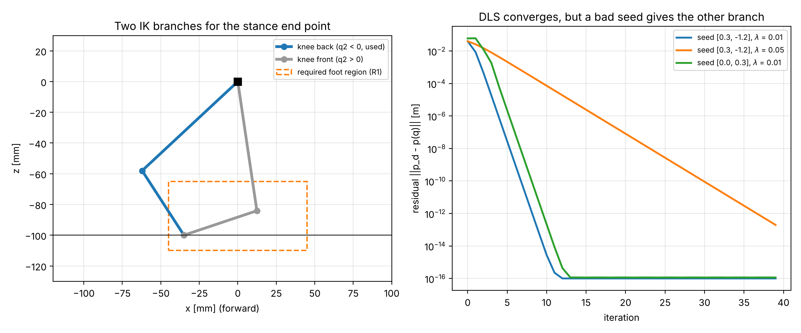

# Quadruped Walking Robot: Design Project

**Course:** Introduction to Robotics, NTUST, Fall 2026 (final project)
**Team:** Ian Ruiz Diaz, Gonzalo Silvano, Josias Mendez, Misael Cuevas

> Work in progress. We add the project here step by step (see the progress list below).

## Project intro

We are designing a small **4-legged walking robot**, about the size of the toy spider kits, using the tools
from this course. Every leg has **2 joints** (hip and knee) driven by hobby servos, so every leg is the
**planar 2R robot** we used in the homeworks. The robot has 8 servos in total. The leg layout is like
Boston Dynamics' Spot (knee pointing back on all legs), but much simpler: Spot has 3 joints per leg.

**Why 2 joints per leg?** For walking straight the foot only has to move forward/back (x) and up/down (z),
so 2 joints are the minimum (Chapter 8: the number of joints should match the task). A third joint per leg
would let the robot turn and sway sideways, but it needs 12 servos instead of 8.

**Task:** walk straight on a flat floor, carry a 50 g sensor on top, step over a 15 mm cable, and never fall
over (statically stable walking).

We follow the method of Lesson 10:

> task → measurable requirements → design variables → models → verification → redesign

## Requirements (R)

| Req. | Requirement | Metric (pass/fail) |
|---|---|---|
| R1 | The foot reaches the whole region needed for walking: stride up to 70 mm, body height 100 ± 10 mm, lift 25 mm | coverage of the region = 100 % |
| R2 | The knee is never close to straight (singularity) | \|q2\| ≥ 20°, i.e. min \|sin q2\| ≥ 0.342 |
| R3 | Carries a 50 g payload, still OK with +50 % (75 g) | servo torque ratio ≤ 1 with 75 g |
| R4 | Walking speed ≥ 3.33 cm/s (1 m in 30 s) | speed from the gait timing |
| R5 | Servo limits: torque ≤ 50 % of stall torque, speed ≤ 70 % of no-load speed | max ratio ≤ 1 |
| R6 | Static stability: the center of mass (COM) stays inside the support polygon | stability margin ≥ 5 mm |
| R7 | The body does not sag in stance (servos give way under load) | body height error ≤ 2 mm |
| R8 | The swing foot follows the planned path (to clear the obstacle) | tracking error ≤ 5 mm |

## Progress

- [x] **Part 1:** robot model, frames and COM, DH table and forward kinematics, inverse kinematics
- [ ] Part 2: Jacobian and forces, gait and static stability, foot trajectory
- [ ] Part 3: leg length design study, servo torque and speed check
- [ ] Part 4: servo control, verification matrix, final design

## Part 1: model and kinematics

### Frames and center of mass (`01_frames_and_com.py`, Lessons 1–3 and 7)
Each leg has a base frame {0} at the hip with x0 pointing down and y0 pointing back, so the leg is exactly
the planar 2R robot from class. The feet are found with W_T_B · B_T_0 · 0_T_foot. We also check what a 5°
body pitch does to the legs (−6.6 … +7.4 mm, inside the ±10 mm of R1) and compute the COM as a weighted
average. Mass budget: **386 g** (core 160 g, payload 50 g, 8 MG90S servos 107 g, PLA legs 69 g).



### DH table and forward kinematics (`03_leg_dh_fk.py`, Lesson 4)

| i | a(i−1) | α(i−1) | d(i) | θ(i) |
|---|---|---|---|---|
| 1 | 0 | 0 | 0 | q1 (hip) |
| 2 | l1 = 85 mm | 0 | 0 | q2 (knee) |

Foot: 2_T_F = Tx(l2 = 50 mm). The DH chain and the direct formula give the same foot position for 500
random poses (error below 1e-16 m), and all rotation matrices have RᵀR = I and det R = 1.



### Inverse kinematics (`04_leg_ik.py`, Lesson 5)
The leg IK has two branches (knee back / knee front). We always use **knee back** (q2 < 0); the other
branch hits the knee limit. FK(IK(p)) gives back p for every point of the required foot region. A DLS solver
also converges, but from a bad seed it goes to the other branch, so the robot will use the analytical IK.



## How to run

```bash
pip install numpy matplotlib
python 01_frames_and_com.py
python 03_leg_dh_fk.py
python 04_leg_ik.py
```

Figures are saved in `figures/`, numbers in `results/`. `quadruped.py` has the robot data and the models,
so every script uses the same numbers.

## References

- J. J. Craig, *Introduction to Robotics: Mechanics and Control* (course textbook).
- Introduction to Robotics course slides and Python scripts, Lessons 1–10.
